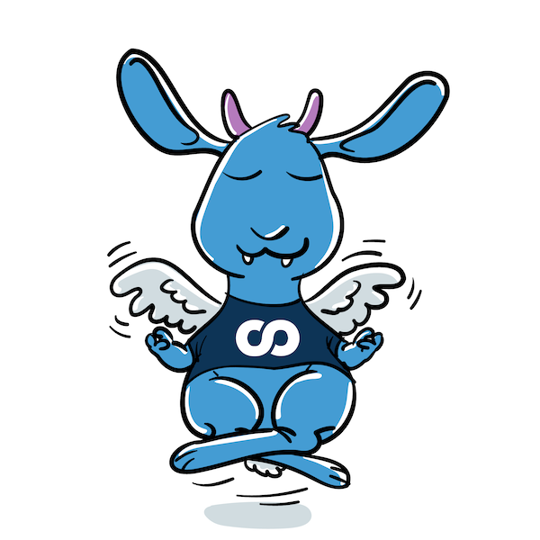

[](https://github.com/foomo/gocontemplate/actions/workflows/github-code-scanning/codeql)
[](https://app.codecov.io/gh/foomo/gocontemplate)
[](https://godoc.org/github.com/foomo/gocontemplate)
[](https://github.com/foomo/gocontemplate)

<p align="center">
  
</p>

# Go Contemplate

> A code generation helper.

Wrapper library around `golang.org/x/tools/go/packages` to filter only defined types and their dependencies.

## Example

```go
package main

import (
  "github.com/foomo/gocontemplate/pkg/contemplate"
)

func main() {
  ctpl, err := contemplate.Load(&contemplate.Config{
    Packages: []*contemplate.PackageConfig{
      {
        Path:  "github.com/foomo/sesamy-go/event",
        Types: []string{"PageView"},
      },
    },
  })
  if err != nil {
    panic(err)
  }
}
```

## How to Contribute

Contributions are welcome! Please read the [contributing guide](docs/CONTRIBUTING.md).


## License

Distributed under MIT License, please read the [license file](LICENSE) for more details.

_Made with ♥ [foomo](https://www.foomo.org) by [bestbytes](https://www.bestbytes.com)_
